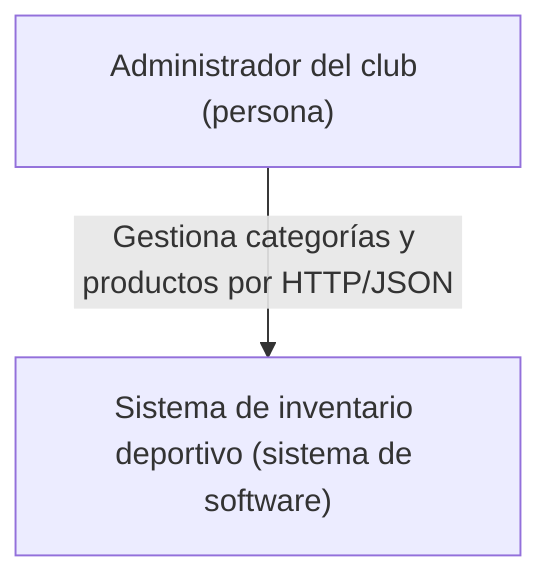
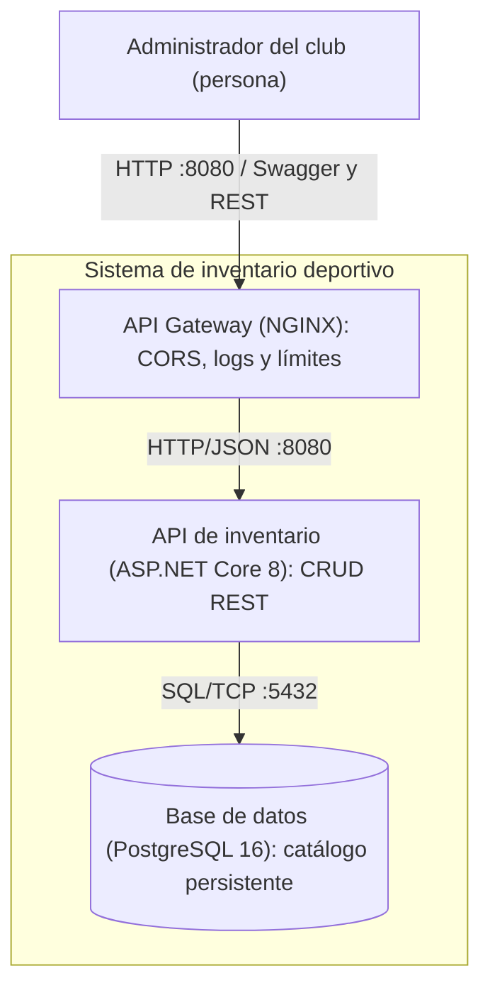

# Diagramas C4

## Nivel 1 - Contexto

El alcance no requiere otros sistemas externos.

## Nivel 2 - Contenedores

Únicamente el Gateway publica puerto al host. Backend y BD usan nombres DNS de Compose en la red bridge. Un volumen nombrado conserva los datos PostgreSQL. La interfaz Swagger forma parte del backend; no es un cuarto contenedor.
